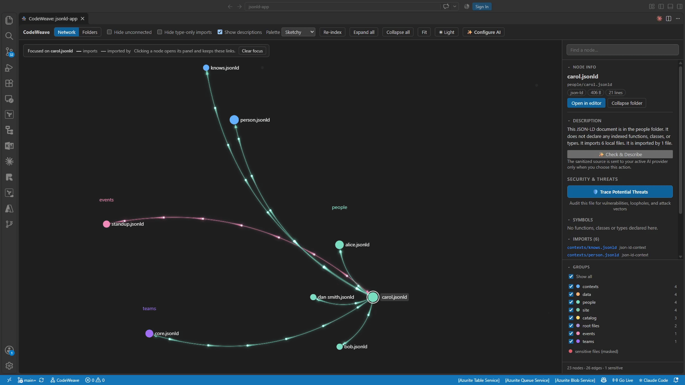

### Hi there, I'm Elmor Cabalfin! 👋 

## **Senior Software Engineer | .NET · Azure · Full-Stack | AI-Assisted Development**

I have 10+ years of experience building and shipping full-stack applications across the .NET, Azure and Node.js ecosystems. I now use **Claude Code** every day to plan, build, test, review and release software faster, without lowering the quality bar.

- 🎯 **Currently**: Full Stack NodeJS/Azure Application Developer at CoDev (since Dec 2023). I replace legacy Access and desktop apps with Blazor Server, and I build .NET 10 Azure Function integrations between SAP, Dynamics 365 Field Service and UKG Pro.
- 🔎 **Open to**: Software Engineering roles where AI-assisted development is part of the daily workflow.
- 💬 **Ask me about**: .NET 10, Blazor, Azure, Clean Architecture, CQRS, Vertical Slice, CI/CD with GitHub Actions and Azure DevOps, and working with Claude Code.
- 📫 **Reach me**: [LinkedIn](https://www.linkedin.com/in/codewithelmor) or [codewithelmor@gmail.com](mailto:codewithelmor@gmail.com)

## 🤖 How I work with AI

I treat Claude Code as a team member that needs clear direction and review, not as an autocomplete. My setup includes:

- **A plan before code.** Each app starts with a product brief, requirements and architecture decisions. The AI builds from an approved plan, one user story at a time.
- **Tests and quality gates.** The AI writes tests for each acceptance criterion. Linting, analyzers, architecture tests and CI pipelines check the result before anything merges.
- **Specialist agents and skills.** I use a set of Claude Code kits (below) so the AI follows the same conventions, security checks and review steps every time.
- **A human decides.** I review every change, own the design decisions, and keep secrets and real data out of prompts.

## 🧰 Claude Code setup

Kits of agents, skills, hooks and starter templates that make Claude Code follow team-grade practices:

| Kit | Covers |
|---|---|
| Product Planning | Idea, requirements, UX, architecture, backlog, build, spec-driven development with Spec Kit, demo video and launch content |
| .NET | .NET 10 apps and APIs, with database, Dynamics 365, Azure Function, API testing (Postman and `.http`) and web front-end teams |
| Angular | Angular apps with signals, zoneless, testing and security review |
| React | React and Next.js apps with tested starters |
| Vue | Vue 3 and Nuxt apps |
| NestJS | NestJS back ends with a tested starter |
| Python | Python apps, scripts, APIs and AI apps |
| GitHub Actions | Writing, securing and fixing GitHub Actions CI/CD |
| Azure Pipelines | Writing, securing and fixing Azure DevOps YAML pipelines |
| Figma Design | Figma design systems that match the UI library used in code |

## 🚀 Demo apps

Projects built with AI assistance, each with its own docs and a narrated demo video.

| App | What it shows | Stack |
|---|---|---|
| **Orders API** ([API demo](https://www.loom.com/share/080eb5eb165e4b348c97391de56e3aa7), [web demo](https://www.loom.com/share/6a5947ed42944354bd3e15c2c57c2def), [web demo bootstrap](https://www.loom.com/share/2d7133e432f84859a80b386570740c1d), [web demo material ui](https://www.loom.com/share/de00d06b0ffe45e09b90f99b3aec5aca), [architecture tour](https://www.loom.com/share/bdaf397af4e44e998f309976b915aaf2)) | REST API for products, customers and orders with Admin and Customer roles. Clean Architecture with vertical slices, CQRS, soft delete with audit trail, rotated refresh tokens, rate limiting, caching, ETag concurrency and a full test pyramid. A React front end sits behind an ASP.NET Core BFF. | .NET 10, FastEndpoints, PostgreSQL, EF Core, Dapper, Valkey, React, Docker, Azure Pipelines |
| **Vertical Slice with FastEndpoints** ([demo](https://www.loom.com/share/264cb52a18484491af956ac36a1bd999)) | Feature-per-folder Web API with JWT auth, role-based authorization, API versioning, JSON and XML content negotiation, and Scalar API docs. | .NET 10, FastEndpoints, EF Core, SQL Server, Dapper |
| **GitSense** ([demo](https://www.loom.com/share/c089eda00a534971885da882b8fb59b0), [download VSIX](https://drive.google.com/file/d/1BjRioFCzUaDpRwx2IcPDwKKe7MJLMID8)) | VS Code extension that brings Git blame, history and a commit graph into the editor, using your local `git` with no account or cloud service. Shows the author, date and message of the current line, with hovers, CodeLens and blame, heatmap and changes annotations. Step back through a file's history with diffs against any revision, and use File and Line History views and a Visual File History chart of commits by author. Sidebar views for commits, branches, remotes, stashes, tags, contributors and worktrees, commit search by message, author, SHA, file or code change, and ref comparisons. A Commit Graph with lanes, ref badges and right-click actions (checkout, branch, cherry-pick, revert, reset), plus export of the loaded commits to JSON, CSV or a Markdown table with each author's own timezone, a drag-and-drop interactive rebase editor, a Git Command Palette that confirms before anything destructive, and links to commits, files, branches and pull requests on GitHub, GitLab, Bitbucket, Azure DevOps, Gitea and self-hosted servers.   | TypeScript, VS Code Extension API, Webviews, Git, npm workspaces |
| **CodeWeave** ([demo](https://www.loom.com/share/e241ffb0efb24e4ba7233a924f8f4010), [download VSIX](https://drive.google.com/file/d/1PCAzapRCQ5ojN5fC91-RhTgMKlhVGrqX)) | VS Code extension and local browser service that shows a codebase as a live network of files and imports instead of a folder tree. Every file is a node and every import an edge: click a node to read its functions, follow its connections and see which files depend on it. Repositories with more than 150 files open as collapsible folder clusters, and a Folders view keeps the familiar tree in sync with the network. Parses TypeScript and JavaScript (tsconfig paths, monorepo packages), C# and .NET (namespaces, usings, project references, NuGet packages), Java, Kotlin, Scala and Groovy (packages, imports, Gradle and Maven modules), Python (packages, `src/` layouts, `pyproject.toml` and requirements) and Dart and Flutter (`package:` imports, part files, `pubspec.yaml`), all through WebAssembly with no .NET SDK, JDK, Python or Flutter install needed. Links JSON-LD files to the context documents and other files they reference. Reads SQL schema scripts, migrations and stored procedures for PostgreSQL, SQL Server, MySQL, Oracle and SQLite, links each script to the files that define the tables it uses, and links ORM models and raw queries (EF Core, JPA, SQLAlchemy, Django, Prisma, Dapper and more) to the script that creates their table. Optionally connects read-only to a live database so its tables, views and routines appear as nodes, with an ER diagram and the differences from the repo's scripts. Shows doc comments on hover (XML docs, JSDoc, Javadoc, KDoc, docstrings, Dart `///`, SQL comments), a plain-language summary of each file, live updates within a second of saving, and incremental indexing (about 800 files in 1 s cold, 0.3 s warm; dotnet/eShop in 1.6 s cold, 0.4 s warm). Secrets in `.env`, settings, Spring and Gradle properties, key and credential files stay masked, database passwords in SQL scripts and connection strings are hidden, the service only listens on 127.0.0.1 behind a token, and optional bring-your-own-key AI checks (OpenAI, Anthropic, xAI or Google) describe a file or trace security threats.   | TypeScript, Node.js, VS Code Extension API, Sigma.js, WebGL, WebAssembly, esbuild, Vitest |
| **Solar System Explorer** ([explore it](https://solar-system-tawny-zeta.vercel.app/)) | Real-time, true-to-scale 3D model of the Solar System for classrooms, showing every world at its real position for any date from 1000 to 3000 AD. Fly to the Sun, the 8 planets, 460 moons, dwarf planets, comets with growing tails and 52,665 real asteroids and Kuiper Belt objects, each on its own orbit, under 9,096 real stars. Real solar and lunar eclipses (including the "blood moon"), moon shadows on Jupiter and Saturn's ring shadows, plus a view of the sky from any world. A guided tour, famous events, live distances and light travel times, time controls from real time to 10 years per second, and full-screen mode for projectors. Orbits come from NASA/JPL data and tests check them against the 2024 solar and 2022 lunar eclipses. | Vite, WebGL 2, Vercel |
| **Human Anatomy** ([explore it](https://human-anatomy-ashen.vercel.app/)) | Interactive, animated 3D model of the male and female human body in the browser. Turn each of 11 organ systems on or off, show one alone or fade it with its own opacity slider, from skin as hologram, X-ray or solid down to the skeleton. Everything moves: the heart beats and arteries pulse in time, blood flows out and back, the lungs and ribs breathe, food moves through the gut, nerve signals spark and glands release hormones. Click any organ to fly to it and read what it does, key facts and how it differs between men and women. A vitals bar with heart and breathing rate sliders and a live ECG, a guided tour, organ search and keyboard shortcuts. All geometry is generated in code, with no external 3D model files. A simplified teaching model, not a medical reference. | React, TypeScript, Vite, WebGL 2, Vercel |
| **TAKBO, TATAY!** ([play it](https://nakabuntis-runner-game.vercel.app/)) | Original 3D Filipino street runner, all in Tagalog: *Ang Takbuhan ng Nakabuntis*. It is a hot Friday afternoon in Barangay Maligaya and the joke is on the runaway father: three mothers he left have found him at the kanto, all at once, each with his crying baby in her arms, *"Jepoy! Sustento!"* You run faster the longer you last and steer past a neighbour's laundry tubs, parked jeepneys, fishball carts, tricycles, kids playing *patintero*, a rooster and his barkada crossing, Marites jumping out to ask if it is true you have children all over town, diving saranggola and an inuman table across the road (*"Shot muna, pare!"*), while every stop costs you one palusot (*"Hindi sa akin 'yan!"*) until the mothers surround you, rocking their babies: *"Panagutan mo kami!"* Collect barya and pandesal, earn an extra palusot from your sweldo envelope, and grab a cup of taho for a *taho rush* that speeds you up, pulls in coins and bursts through anything in your path. A new zone blends in every 1,000 metres (the kanto with sari-sari stores and *FAMILY PLANNING: LIBRE SA HEALTH CENTER* tarpaulins, the palengke with striped awnings and ihaw-ihaw, Lumang Bayan with bahay na bato and a ringing church bell, and Tabing-Dagat with nipa huts, bancas and drying daing), each with its own daytime sky, weather, scenery and music (rondalla, brass band, fiesta band, guitar and tambourine). Six fathers on the run on a skinned 18-bone procedural rig, from a tambay in a sando to a seaman on vacation with a gold chain, plus tsinelas slapping the road and babies wailing louder as the mothers close in, a mother popping up with *"SUSTENTO, JEPOY!"* whenever you stumble, a live heart-rate trace and Tagalog banners like *HULING PALUSOT!* Play with keyboard, touch or gamepad, or watch a bot run at Baguhan, Bihasa or Alamat skill and press T to take over. Fixed 60-tick rules with a seeded RNG, so a seed always plays out the same way. Sound and music are made in the browser with Web Audio, and reduced motion is respected. The mothers are drawn as ordinary neighbours, there is no sexual content and no violence: being caught ends with you paying sustento. | React 19, TypeScript, Vite, three.js, Motion, Web Audio, Vercel |
| **Habulan sa 5-6** ([play it](https://utang-runner-game.vercel.app/)) | Original 3D Filipino street runner, all in Tagalog. It is a hot Friday afternoon in Barangay Maligaya, you owe the 5-6 ₱6,000 on a ₱5,000 loan, and today is collection day: the collector is at the kanto on his motorcycle, umbrella up and listahan in hand, *"Kuya! Bayad na!"* You run faster the longer you last and steer past a neighbour's laundry tubs, parked jeepneys, fishball carts, tricycles, kids playing *patintero*, a rooster and his barkada crossing, Marites jumping out to ask if it is true you owe the 5-6, diving saranggola and an inuman table across the road (*"Shot muna, pare!"*), while every stop costs you one palusot (*"Bukas na lang po!"*) until the collector catches you. Collect barya and pandesal, earn an extra palusot from your sweldo envelope, and grab a cup of taho for a *taho rush* that speeds you up, pulls in coins and bursts through anything in your path. A new zone blends in every 1,000 metres (the kanto with sari-sari stores and *BAWAL ANG UTANG* signs, the palengke with striped awnings and ihaw-ihaw, Lumang Bayan with bahay na bato and a ringing church bell, and Tabing-Dagat with nipa huts, bancas and drying daing), each with its own daytime sky, weather, scenery and music (rondalla, brass band, fiesta band, guitar and tambourine). Six neighbours in debt on a skinned 18-bone procedural rig, from a tambay in a sando to a call center agent with her lanyard, plus the collector's motorcycle growing louder as he closes in, a live heart-rate trace and Tagalog banners like *HUWAG KANG LILINGON!* Play with keyboard, touch or gamepad, or watch a bot run at Baguhan, Bihasa or Alamat skill and press T to take over. Fixed 60-tick rules with a seeded RNG, so a seed always plays out the same way. Sound and music are made in the browser with Web Audio, and reduced motion is respected. The collector is drawn with respect, with no caricature or mock accent, and there is no violence: being caught ends with you handing over your last peso bills. | React 19, TypeScript, Vite, three.js, Motion, Web Audio, Vercel |
| **TAKBO, NINONG!** ([play it](https://ninong-ninang-runner-game.vercel.app/)) | Original 3D Filipino Christmas runner. It is December in Barangay San Isidro, the parols are lit and every inaanak you ever stood for at a baptism is on the road with a hand out: *"Mano po, Ninong! Pamasko po!"* You are the Ninong or Ninang in a Santa hat, running faster the longer you last and steering past piles of regalo "Para kay Ninong", tinsel-covered Christmas jeepneys, lines of carolers with tansan tambourines, ankle-grabbing bulilit, teenagers leaping out for a *mano po*, cousins swooping down on giant flying parols (the glow on the road shows where they swoop) and Noche Buena tables waving you over, while every catch empties one wallet and lets the crowd close in. Collect barya and hamon, refill a wallet with your 13th-month pay, and grab the red sobre for a *pamasko shower* that hands an envelope to everyone in your path. A new zone blends in every 1,000 metres (Barangay San Isidro with nipa huts and belens, the dawn Masses of Simbang Gabi with bibingka stalls, the giant lanterns of Ligligan Parul, and Noche Buena sa Baybay with fireworks over the sea and the Star of Bethlehem), each with its own sky, weather, scenery and music (rondalla, church organ, brass band, pots and sleigh bells), by night or by day. Six godparents on a skinned 18-bone procedural rig, from a balikbayan home from Dubai to the barangay captain in a barong, plus inaanak voices, confetti and fireworks, a live heart-rate trace and Tagalog banners like *HULING PITAKA!* Play with keyboard, touch or gamepad, or watch a bot run at Rookie, Pro or Legend skill and press T to take over. Fixed 60-tick rules with a seeded RNG, so a seed always plays out the same way. Sound and music are made in the browser with Web Audio, and reduced motion is respected. No violence: being caught ends in confetti. | React 19, TypeScript, Vite, three.js, Motion, Web Audio, Vercel |
| **Sugarsaur Sprint** ([play it](https://dinosaur-game-bay.vercel.app)) | Original 3D endless runner set in a world of desserts. A gummy dino runs by itself while you jump cupcakes, jelly cubes, macaron towers and rolling donuts, duck flapping toffee birds and ride sugar rushes. A new world rolls in every 1,000 points (Frosting Fields, Chocolate Canyon, a night carnival with fireworks and a snowy Sorbet Glacier), each with its own sky, scenery, weather and music. Candy explosions, a rainbow trail, bloom, zoom blur and slow motion on crash, plus a chase camera or classic side view. Play with keyboard, touch or gamepad, or watch a bot run at Rookie, Pro or Legend skill and press T to take over. Fixed 60-tick rules with a seeded RNG, so a seed always plays out the same way. Sound and music are made in the browser with Web Audio, and reduced motion is respected. | React 19, TypeScript, Vite, three.js, Motion, Web Audio, Vercel |
| **Monster Rapids** ([play it](https://river-game-three.vercel.app)) | Original 3D river rowing adventure. The current carries your rowboat downriver faster and faster while you steer across the river past rocks, drifting logs, water snakes, lunging alligators, leaping giant fish and piranha swarms. Collect coins, treasure chests and life rings that patch the hull, and grab the Thunder Paddle to smash everything for a few seconds. A new river blends in every 1,000 points (Emerald Jungle, Sunset Canyon, a moonlit bayou with fireflies and an aurora, and an icy Glacier Fjord), each with its own sky, scenery, weather and music. The rower pulls real strokes with inverse-kinematics arms, and the boat rides shader waves with sky reflections, foam and a wake. Play with keyboard, touch or gamepad, or watch a bot row at Rookie, Pro or Legend skill and press T to take over. Fixed 60-tick rules with a seeded RNG, so a seed always plays out the same way. Sound and music are made in the browser with Web Audio, and reduced motion is respected. | React 19, TypeScript, Vite, three.js, Motion, Web Audio, Vercel |
| **Dead Mile** ([play it](https://zombie-runner-game-henna.vercel.app/)) | Original 3D zombie survival runner. It is 3:07 a.m., the town is burning and the horde is at your heels: you run faster the longer you last and steer across the road past corpse piles, burning wrecks, shamblers, crawlers, lungers, leapers and feeding packs, while every hit slows you and lets the horde close in. Collect dog tags, supply caches and medkits, and grab the chainsaw to carve through everything for a few seconds. A new zone blends in every 1,000 metres (the burning suburb of Hollow Pines, Route 13 under a blood moon, St. Agnes Cemetery with hands reaching from the graves, and the fallen army camp of Quarantine Zone 9), each with its own sky, weather, scenery and music, by night with a flashlight that throws real shadows or by day under a dead sky. Six survivors on a skinned 18-bone procedural rig with a full running gait, plus gore effects, a live ECG and heartbeat-red screen edge when hurt. Play with keyboard, touch or gamepad, or watch a bot run at Rookie, Pro or Legend skill and press T to take over. Fixed 60-tick rules with a seeded RNG, so a seed always plays out the same way. Sound and music are made in the browser with Web Audio, and reduced motion is respected. Contains graphic horror violence and gore. | React 19, TypeScript, Vite, three.js, Motion, Web Audio, Vercel |
| **TAKBO: Gabi ng Aswang** ([play it](https://filipino-horror-runner-game.vercel.app/)) | Original 3D Filipino folklore horror runner. It is 3:07 a.m. in Barrio San Isidro, something on the roof goes *tik... tik... tik...*, and a pack of Aswang is at your heels on the last provincial road out: you run faster the longer you last and steer past the Nuno sa Punso's anthill, the Kapre on his burning jeepney, crawling Tiyanak, lunging Tikbalang, diving Manananggal (her shadow shows where she lands) and Aswang families at their dinner, while every wound slows you and lets the pack close in. Collect anting-anting and bawang, close wounds with agua bendita, and grab the buntot pagi whip to flay everything in your path for a few seconds. A new zone blends in every 1,000 metres (Barrio San Isidro with nipa huts and fireflies, Balete Drive under a blood moon with a White Lady by the road, the candlelit Sementeryo ng Undas, and the coast road of Dagat ng Bakunawa where a sky-sized serpent swallows the moon), each with its own sky, weather, scenery and music (kulintang, pasyon chant, pots and gongs), by night or by day. Six Filipino survivors on a skinned 18-bone procedural rig, creature voices, gore effects, jumpscares, a live ECG and Tagalog banners like *HUWAG KANG LILINGON*. Play with keyboard, touch or gamepad, or watch a bot run at Rookie, Pro or Legend skill and press T to take over. Fixed 60-tick rules with a seeded RNG, so a seed always plays out the same way. Sound and music are made in the browser with Web Audio, and reduced motion is respected. Contains graphic horror violence, gore and jumpscares. | React 19, TypeScript, Vite, three.js, Motion, Web Audio, Vercel |
| **Chess Duel 3D** ([play it](https://chess-3-d-game.vercel.app/)) | Real-time two-player chess with no sign-in: create a game, share the code or link, and play from any browser or device, then swap colors for the rematch, with match points across rematches. Full FIDE rules checked on the server (castling, en passant, promotion, checkmate and automatic draws by stalemate, insufficient material, the 50-move rule and threefold repetition) by a dependency-free engine. Pieces slide, get knocked off and topple on checkmate, plus draw offers and resign, a WebSocket relay or SignalR hub, and a keyboard-playable board with WCAG 2.2 AA accessibility. | React 19, TypeScript, Vite, Motion, SignalR, WebSockets, Vercel, Render |
| **Snakes & Ladders Online** ([play it](https://snakes-and-ladder-game.vercel.app)) | Real-time two-player Snakes & Ladders with no sign-in: create a game, share the code or link, and play from any browser or device. Animated SVG board with idling snakes, hopping pawns and a 3D CSS dice, a WebSocket game relay (or any SignalR hub that implements the shared contract), reconnects, reduced-motion support and WCAG 2.2 AA accessibility. | React 19, TypeScript, Vite, Motion, SignalR, WebSockets, Vercel, Render |
| **Crossword Clash** ([play it](https://scrabble-game-xi.vercel.app/)) | Real-time crossword tile game for 2–4 players with no sign-in: create a game, share the code or link, and build words on a 15 × 15 board with letter and word premiums and a 50-point bingo. Hidden racks kept on the server, a 168,000-word dictionary with a meaning for almost every word (plus newer Merriam-Webster words like RIZZ and SELFIE), animated tiles and scoring, a WebSocket relay or SignalR hub, and a keyboard-playable board with WCAG 2.2 AA accessibility. | React 19, TypeScript, Vite, Motion, SignalR, WebSockets, Vercel, Render |
| **Chess Duel** ([play it](https://chess-game-tan-iota.vercel.app)) | Real-time two-player chess with no sign-in: create a game, share the code or link, and play from any browser or device, then swap colors for the rematch. Full rules checked on the server (castling, en passant, promotion, checkmate and automatic draws) by a dependency-free engine, animated pieces that slide, get knocked off and topple on checkmate, draw offers and resign, a WebSocket relay or SignalR hub, and a keyboard-playable board with WCAG 2.2 AA accessibility. | React 19, TypeScript, Vite, Motion, SignalR, WebSockets, Vercel, Render |
| **Dama** ([play it](https://dama-game-tau.vercel.app)) | Real-time two-player Dama (Filipino checkers) with no sign-in: create a game, share the code or link, and play from any browser or device, then swap colors for the rematch. Compulsory and multi-jump captures, flying kings and crowning checked on the server by a dependency-free rules engine, with automatic draws, draw offers and resign. Animated pieces that slide hop by hop, get knocked off into the captured tray and spin in a crown, a WebSocket relay or SignalR hub, and a keyboard-playable board with WCAG 2.2 AA accessibility. | React 19, TypeScript, Vite, Motion, SignalR, WebSockets, Vercel, Render |
| **Sungka** ([play it](https://sungka-game.vercel.app/)) | Real-time two-player Sungka (the Filipino mancala game) with no sign-in: create a game, share the code or link, and sow your shells from any browser or device, then swap who goes first for the rematch. Sowing, relay sowing, extra turns and captures checked on the server by a dependency-free rules engine, with draw offers and resign. Original carved *narra*-wood board art, a hand that scoops and drops every shell, captures that fly into the store, an animated How to play guide, a WebSocket relay or SignalR hub, and a keyboard-playable board with WCAG 2.2 AA accessibility. | React 19, TypeScript, Vite, Motion, SignalR, WebSockets, Vercel, Render |
| **Connect Four** ([play it](https://connect-four-game-two-ivory.vercel.app)) | Real-time two-player Connect Four with no sign-in: create a game, share the code or link, and drop your discs from any browser or device, then swap who goes first for the rematch. Gravity, four in a row (across, up and down, or diagonal) and full-board draws checked on the server by a dependency-free rules engine, with draw offers and resign. Original stand and disc art, discs that fall and bounce behind the front panel, a winning line drawn through the four, an animated How to play guide, a WebSocket relay or SignalR hub, and a keyboard-playable board with WCAG 2.2 AA accessibility. | React 19, TypeScript, Vite, Motion, SignalR, WebSockets, Vercel, Render |
| **Timber Tower** ([play it](https://jenga-game-chi.vercel.app)) | Real-time two-player tumbling-tower game in the style of Jenga with no sign-in: create a game, share the code or link, and take turns easing a block out of the tower and stacking it on top from any browser or device, then swap who goes first for the rematch. Pulls, placement and tower balance checked on the server by a dependency-free rules engine, with a steady-hand meter that lowers the chance of a risky fall, draw offers and resign. A 3D tower in CSS transforms (no WebGL) where blocks slide out, lift and drop with gravity, the tower wobbles, and a collapse is a seeded rigid-body physics simulation every player sees the same way, an animated How to play guide, a WebSocket relay or SignalR hub, and a keyboard-playable Blocks list with WCAG 2.2 AA accessibility. | React 19, TypeScript, Vite, Motion, SignalR, WebSockets, Vercel, Render |
| **Broadside** ([play it](https://battleship-game-ochre.vercel.app)) | Real-time two-player take on the classic Battleship game with no sign-in: create a game, share the code or link, secretly deploy a fleet of five warships on a 10 × 10 sea, and trade missile fire from any browser or device, then swap who fires first for the rematch. Fleet placement, shots, hits and sinkings checked on the server by a dependency-free rules engine that keeps each fleet hidden from the opponent, with surrender. Original ship art, missiles that fly in on an arc with a smoke trail, splashes, hits that burn until the battle ends, sunk ships that settle into the water, both players alerted to every hit at once, an animated How to play guide, a WebSocket relay or SignalR hub, and keyboard-playable boards with screen-reader announcements. | React 19, TypeScript, Vite, Motion, SignalR, WebSockets, Vercel, Render |
| **Mazeshift** ([play it](https://labyrinth-game-alpha.vercel.app)) | Real-time shifting-maze treasure hunt for 2–4 players with no sign-in: create a game, share the code or link, and on each turn push the spare tile in from the edge to slide a whole row or column of the 7 × 7 maze, then walk your pawn along the open paths to collect your secret treasures one at a time and race home to your corner, from any browser or device. Pushes, paths, treasures and wins checked on the server by a dependency-free rules engine that keeps each player's next target hidden, with resign and rematches on a new maze. Original tile, pawn and treasure art, lines that slide in with a spring while the pushed-out tile tips away, pawns that wrap around the board, reachable squares that light up in a ripple, every player alerted to each treasure found, an animated How to play guide, a WebSocket relay or SignalR hub, and a keyboard-playable board with WCAG 2.2 AA accessibility. | React 19, TypeScript, Vite, Motion, SignalR, WebSockets, Vercel, Render |
| **Nova Strike** ([play it](https://space-impact-game.vercel.app)) | 3D side-scrolling space shooter in the style of the classic phone shooters such as *Space Impact*, with no sign-in: fly alone, take on a bot pilot (Cadet, Ace or Legend), duel a friend on one keyboard or two gamepads, or create an online room and share the link. Three sectors of scripted enemy waves, each ending in a giant boss that changes attack patterns as it weakens, with combo multipliers up to ×8, blaster upgrades, shields, extra ships, and seeker missiles, ion lance and nova bomb specials. A deterministic 60 Hz simulation with no dependencies runs in the browser; in online duels the host streams snapshots through a WebSocket relay while the guest predicts its own ship. Everything is drawn live in three.js with a tilted 3D camera, nebulas, ringed planets, bloom, layered explosions and slow-motion boss deaths, with sound and music generated by Web Audio, keyboard, gamepad and touch controls, and screen-reader announcements with reduced-motion support. | React 19, TypeScript, Vite, three.js, Motion, Web Audio, WebSockets, Vercel, Render |
| **Nova Sweep** ([play it](https://minesweeper-game-lovat.vercel.app)) | 3D minesweeper set in deep space with no sign-in: sweep alone against the clock, race a bot (Cadet, Ace or Legend) or a friend on one keyboard on identical fields, or create an online room and share the link. Three fields from 9 × 9 to 30 × 16 with 99 mines, a safe first click, cascades, flags and chording, three shields per player in races, and best times saved per field. Dependency-free rules that are deterministic from a seed run in the browser; in online races both browsers play the same seeded fields and trade actions, not state, through a WebSocket relay, with the host deciding the winner. Everything is drawn live in three.js: tiles rain in, cascades ripple out ring by ring, mines detonate in a chain reaction on a loss, and a cleared field sends a light wave across the floor with fireworks, with bloom, camera shake, a cinematic intro and sound and music generated by Web Audio. Mouse, touch and keyboard controls, and screen-reader announcements with reduced-motion support. | React 19, TypeScript, Vite, three.js, Motion, Web Audio, WebSockets, Vercel, Render |
| **YouTube Downloader** ([demo](https://www.loom.com/share/31d2c586af424e3b90166b59c791a739)) | Turns a YouTube link into tagged MP3, MP4 or captions, from the command line or a desktop app. | Python, yt-dlp, FFmpeg, Electron |
| **Spotify to MP3 Downloader** ([demo](https://www.loom.com/share/6c5c436b6d684541be871e3cc557cbcf)) | Turns a Spotify track, album or playlist link into tagged MP3 files with cover art. | Python, Electron |
| **Audio Album Art Embedder** ([demo](https://www.loom.com/share/1372a2ca701842a1982d7209af099c70)) | Embeds a cover image (JPG or PNG) into the FLAC, MP3, M4A/MP4 and AAC files of a folder, replacing any existing art. Auto-detects the cover, saves MP3s as ID3v2.3 so thumbnails show in Windows Explorer, and runs from the command line or a desktop app. | Python, Electron |
| **Video to GIF Converter** ([demo](https://www.loom.com/share/0bb86f1d50a640ca9780481a601ad94e)) | Turns a video into a high-quality GIF using FFmpeg's two-pass palette technique, with FPS and width controls, live progress and a preview. FFmpeg is bundled, and it runs from the command line or a desktop app. | Python, FFmpeg, Electron |
| **Image Tool** ([demo](https://www.loom.com/share/721f4f80b2404040b90f5380f50a2033)) | Resizes, converts and compresses images (JPG, PNG, WEBP, BMP, TIFF, GIF), saving the result next to the original without overwriting. Python and Pillow are bundled, and it runs from the command line or a desktop app. | Python, Pillow, Electron |

## 🤝 Open source contributions

| Project | What I added | Stack |
|---|---|---|
| **[AI Remove Background for OBS Studio](https://github.com/codewithelmor/aisegment_obs_plugin)** (fork of [aisegmentcn/aisegment_obs_plugin](https://github.com/aisegmentcn/aisegment_obs_plugin)) | An OBS video filter that blurs or replaces the background behind a person in real time on the CPU, with no GPU needed. My changes: a **looping video background**, decoded on a worker thread so rendering is never blocked. A **fix for the black output** that custom image and colour backgrounds showed after an OBS restart, with a fallback to the original frame if blending fails. Safer handling of missing or unreadable background images. A **one-command Windows installer** (`install.ps1`) that finds OBS automatically, plus a packaging script that builds a ready-to-extract zip. | C++, OBS Studio, OpenCV, PowerShell |

## 💼 Work highlights

- **UKG → SAP integrations:** a two-host system (Blazor Server and a scheduled Azure Function) that replaced a manual FileZilla-and-Excel process. It includes a UKG SOAP API client built from scratch.
- **SAP Open Orders portal:** a Blazor Server app with Microsoft Entra ID sign-in, embedded Power BI and an Azure Logic App email workflow. It replaced email and phone chains that took up to 48 hours.
- **Field Service integration hub:** .NET 10 Azure Functions that sync Dynamics 365 Field Service with UKG Pro, SAP and Ramp, with retry handlers for the Ramp API and Dataverse.
- **Access to Blazor migration:** a web replacement for an Access database with 1,400+ forms and reports, backed by SQL Server.
- **DevOps:** moved several projects from Azure DevOps to GitHub and built their GitHub Actions CI/CD pipelines.

## 🛠️ Tech stack

- **AI-assisted development:** Claude Code, GitHub Copilot
- **Languages:** C#, TypeScript, JavaScript, Python, Java
- **Backend:** .NET 10, ASP.NET Core Web API, Razor Pages, MVC, ASP.NET Core Identity, Microsoft Entra ID, EF Core, Dapper, REST, SOAP, Node.js
- **Frontend:** Blazor Server, Angular, React, Bootstrap 5, Radzen Blazor
- **Cloud and DevOps:** Azure (Functions, Logic Apps, App Service, SQL Database, Storage, Key Vault, App Insights, Container Registry and Instances), GitHub Actions, Azure DevOps, Docker, Git
- **Data:** SQL Server, Azure SQL, PostgreSQL, MySQL, Power BI Embedded
- **Architecture:** Clean Architecture, CQRS, Vertical Slice, Design Patterns, API versioning and documentation
- **Integrations:** SAP, Dynamics 365 Field Service (Dataverse Web API), UKG Pro (REST and SOAP), Ramp API, Microsoft Graph API
- **Design:** Figma mock-ups and prototypes

## 🎓 Certifications

| Certification | Issuer | Issued | Expires |
|---|---|---|---|
| [GitHub Actions (GH-200)](https://www.credly.com/badges/fbe4b96d-d0f7-4550-bdd5-8c8e2acde98c/linked_in_profile) | GitHub | May 2025 | May 2028 |
| [GitHub Foundations (GH-900)](https://www.credly.com/badges/f8e0427e-bd54-4bf9-9d39-a9010c807ca7/linked_in_profile) | GitHub | Apr 2025 | Apr 2028 |
| [Microsoft Certified: DevOps Engineer Expert (AZ-400)](https://learn.microsoft.com/en-us/users/elmorcabalfin-7003/credentials/6fe8cdc25a258e0a) | Microsoft | Dec 2024 | Dec 2027 |
| [Microsoft Certified: Azure Developer Associate (AZ-204)](https://learn.microsoft.com/en-us/users/elmorcabalfin-7003/credentials/b068ab3444fd1f41) | Microsoft | Dec 2024 | Dec 2027 |
| [Foundational C# with Microsoft](https://www.freecodecamp.org/certification/fccfd25b7f5-c651-4047-8946-ff3821b26635/foundational-c-sharp-with-microsoft) | freeCodeCamp | Sep 2024 | None |
| [Microsoft Certified: Security, Compliance, and Identity Fundamentals (SC-900)](https://learn.microsoft.com/en-gb/users/elmorcabalfin-7003/credentials/c25df1b263924769) | Microsoft | Sep 2024 | None |
| [Microsoft Certified: Azure Data Fundamentals (DP-900)](https://learn.microsoft.com/en-gb/users/elmorcabalfin-7003/credentials/5d66a2cba858672) | Microsoft | Jul 2024 | None |
| [Microsoft Certified: Azure AI Fundamentals (AI-900)](https://learn.microsoft.com/en-gb/users/elmorcabalfin-7003/credentials/bd29b11bafd5d5f5) | Microsoft | Jul 2024 | None |
| [Microsoft Certified: Azure Fundamentals (AZ-900)](https://www.credly.com/badges/133d739d-8606-4d12-9fd8-af83845f69c0) | Microsoft | May 2021 | None |

<!--

-->
