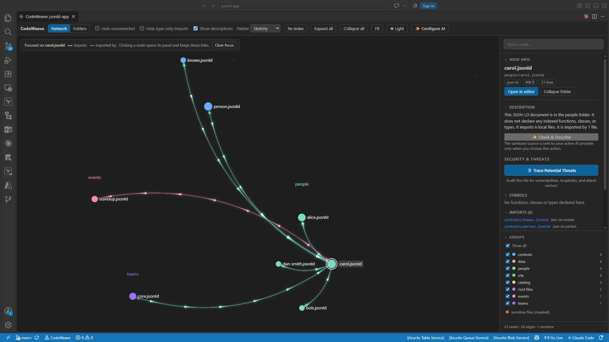
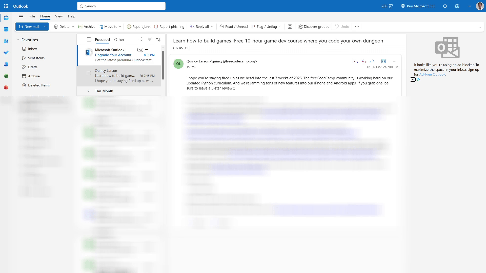

### Hi there, I'm Elmor Cabalfin! 👋 

## **Senior Software Engineer | .NET · Azure · Full-Stack | AI-Assisted Development**

I have 10+ years of experience building and shipping full-stack applications across the .NET, Azure and Node.js ecosystems. I now use **Claude Code** every day to plan, build, test, review and release software faster, without lowering the quality bar.

- 🎯 **Currently**: Full Stack NodeJS/Azure Application Developer at CoDev (since Dec 2023). I replace legacy Access and desktop apps with Blazor Server, and I build .NET 10 Azure Function integrations between SAP, Dynamics 365 Field Service and UKG Pro.
- 🔎 **Open to**: Software Engineering roles where AI-assisted development is part of the daily workflow.
- 💬 **Ask me about**: .NET 10, Blazor, Azure, Clean Architecture, CQRS, Vertical Slice, CI/CD with GitHub Actions and Azure DevOps, and working with Claude Code.
- 📫 **Reach me**: [LinkedIn](https://www.linkedin.com/in/codewithelmor) or [codewithelmor@gmail.com](mailto:codewithelmor@gmail.com)

## 🤖 How I work with AI

I treat Claude Code as a team member that needs clear direction and review, not as an autocomplete. My setup includes:

- **A plan before code.** Each app starts with a product brief, requirements and architecture decisions. The AI builds from an approved plan, one user story at a time.
- **Tests and quality gates.** The AI writes tests for each acceptance criterion. Linting, analyzers, architecture tests and CI pipelines check the result before anything merges.
- **Specialist agents and skills.** I use a set of Claude Code kits (below) so the AI follows the same conventions, security checks and review steps every time.
- **A human decides.** I review every change, own the design decisions, and keep secrets and real data out of prompts.

## 🧰 Claude Code setup

Kits of agents, skills, hooks and starter templates that make Claude Code follow team-grade practices:

| Kit | Covers |
|---|---|
| Product Planning | Idea, requirements, UX, architecture, backlog, build, spec-driven development with Spec Kit, demo video and launch content |
| .NET | .NET 10 apps and APIs, with database, Dynamics 365, Azure Function, API testing (Postman and `.http`) and web front-end teams |
| Java | Java and Spring Boot apps from Java 8 to 27, with database, Dynamics 365, Azure Function, API testing and web front-end (Thymeleaf, htmx, Vaadin) add-ons |
| Angular | Angular apps with signals, zoneless, testing and security review |
| React | React and Next.js apps with tested starters |
| Vue | Vue 3 and Nuxt apps |
| NestJS | NestJS back ends with a tested starter |
| Python | Python apps, scripts, APIs and AI apps |
| GitHub Actions | Writing, securing and fixing GitHub Actions CI/CD |
| Azure Pipelines | Writing, securing and fixing Azure DevOps YAML pipelines |
| Figma Design | Figma design systems that match the UI library used in code |

## 🚀 Demo apps

Projects built with AI assistance, each with its own docs and a demo video or live link.

### Developer tools and APIs

| App | What it shows | Stack |
|---|---|---|
| **Orders API** ([API demo](https://www.loom.com/share/080eb5eb165e4b348c97391de56e3aa7), [web demo](https://www.loom.com/share/6a5947ed42944354bd3e15c2c57c2def), [web demo bootstrap](https://www.loom.com/share/2d7133e432f84859a80b386570740c1d), [web demo material ui](https://www.loom.com/share/de00d06b0ffe45e09b90f99b3aec5aca), [architecture tour](https://www.loom.com/share/bdaf397af4e44e998f309976b915aaf2)) | REST API for products, customers and orders with Admin and Customer roles. Clean Architecture with vertical slices, CQRS, soft delete with audit trail, rotated refresh tokens, rate limiting, caching, ETag concurrency and a full test pyramid. React front end behind an ASP.NET Core BFF. | .NET 10, FastEndpoints, PostgreSQL, EF Core, Dapper, Valkey, React, Docker, Azure Pipelines |
| **Vertical Slice with FastEndpoints** ([demo](https://www.loom.com/share/264cb52a18484491af956ac36a1bd999)) | Feature-per-folder Web API with JWT auth, role-based authorization, API versioning, JSON and XML content negotiation, and Scalar API docs. | .NET 10, FastEndpoints, EF Core, SQL Server, Dapper |
| **GitSense** ([demo](https://www.loom.com/share/c089eda00a534971885da882b8fb59b0), [download VSIX](https://drive.google.com/file/d/1BjRioFCzUaDpRwx2IcPDwKKe7MJLMID8)) | VS Code extension for Git blame, history and a commit graph, using your local `git` (no account or cloud). • **Blame:** current-line author, date and message, with hovers, CodeLens and heatmap. • **History:** step through a file's revisions with diffs, File and Line History views, and a commits-by-author chart. • **Sidebar:** commits, branches, remotes, stashes, tags, contributors and worktrees, plus commit search and ref comparisons. • **Commit Graph:** lanes, ref badges, right-click checkout, branch, cherry-pick, revert and reset, and export to JSON, CSV or Markdown. • **Extras:** drag-and-drop interactive rebase, a Git Command Palette that confirms destructive actions, and links to GitHub, GitLab, Bitbucket, Azure DevOps, Gitea and self-hosted servers.   | TypeScript, VS Code Extension API, Webviews, Git, npm workspaces |
| **CodeWeave** ([demo](https://www.loom.com/share/e241ffb0efb24e4ba7233a924f8f4010), [download VSIX](https://drive.google.com/file/d/1TCU1efvBP9hPLo2i8ge6VRtuwhVEQkmV)) | VS Code extension and local browser service that shows a codebase as a live network of files and imports. Click a file to see its functions, connections and dependents. Repos with 150+ files open as folder clusters, kept in sync with a Folders tree. • **Languages (WebAssembly, no SDK install):** TypeScript/JavaScript, C#/.NET, Java/Kotlin/Scala/Groovy, Python, Dart/Flutter. • **Cross-file links:** HTML, Razor/Blazor, Vue, Svelte, Angular, CSS/SCSS/Sass/Less, JSON Schema and OpenAPI `$ref`s, XML/XSD/XSLT/WSDL/SVG and JSON-LD. Front-end HTTP and SignalR calls link to the matching ASP.NET Core route or hub. • **Infra, gRPC and SQL:** Bicep, Terraform and ARM; `.proto` services linked to gRPC code in 8 languages; SQL scripts for PostgreSQL, SQL Server, MySQL, Oracle and SQLite linked to ORM models (EF Core, JPA, SQLAlchemy, Prisma, Dapper and more). Optional read-only live database view with ER diagram and schema diff. • **Extras:** doc comments on hover, plain-language file summaries, PNG export, live updates under 1 s, and fast incremental indexing (dotnet/eShop in 1.6 s cold, 0.4 s warm). • **Security:** secrets and DB passwords masked, Firebase config and Terraform state withheld, service bound to 127.0.0.1 behind a token. Optional bring-your-own-key AI (OpenAI, Anthropic, xAI, Google) to describe files or trace threats.   | TypeScript, Node.js, VS Code Extension API, Sigma.js, WebGL, WebAssembly, esbuild, Vitest |

### Learning apps

| App | What it shows | Stack |
|---|---|---|
| **Solar System Explorer** ([explore it](https://solar-system-tawny-zeta.vercel.app/)) | True-to-scale, real-time 3D Solar System for classrooms, for any date from 1000 to 3000 AD. Fly to the Sun, 8 planets, 460 moons, dwarf planets, comets and 52,665 real asteroids and Kuiper Belt objects under 9,096 real stars. Real eclipses (including the "blood moon"), moon and ring shadows, the sky from any world, a guided tour, live distances and light travel times, time controls up to 10 years per second, and full-screen mode for projectors. Orbits use NASA/JPL data, tested against the 2024 solar and 2022 lunar eclipses. | Vite, WebGL 2, Vercel |
| **Human Anatomy** ([explore it](https://human-anatomy-ashen.vercel.app/)) | Animated 3D male and female body. Toggle, isolate or fade 11 organ systems, from skin (hologram, X-ray or solid) to skeleton. The heart beats, blood flows, lungs breathe, food moves and nerves spark. Click an organ for its role, key facts and male/female differences. Includes heart and breathing rate sliders with a live ECG, a guided tour and search. All geometry is generated in code. A teaching model, not a medical reference. | React, TypeScript, Vite, WebGL 2, Vercel |

### 3D runner games

All runners: you get faster the longer you last, a new zone every 1,000 m with its own sky, weather, scenery and music, keyboard, touch or gamepad controls, a bot at three skill levels (press T to take over), fixed 60-tick rules with a seeded RNG (same seed, same run), Web Audio sound and music, and reduced-motion support. Character runners use a skinned 18-bone procedural rig. **Stack:** React 19, TypeScript, Vite, three.js, Motion, Web Audio, Vercel

| Game | What it is |
|---|---|
| **TAKBO, TATAY!** ([play it](https://nakabuntis-runner-game.vercel.app/)) | All-Tagalog Filipino street comedy, *Ang Takbuhan ng Nakabuntis*. Three mothers with crying babies chase the runaway father through Barangay Maligaya (*"Jepoy! Sustento!"*). Dodge laundry tubs, jeepneys, fishball carts, *patintero* kids, Marites and an inuman table; each hit costs a palusot. Collect barya and pandesal, and grab taho for a *taho rush*. Zones: kanto, palengke, Lumang Bayan and Tabing-Dagat, with rondalla, brass and fiesta band music. Six fathers, from tambay to seaman. Bot levels: Baguhan, Bihasa, Alamat. No sexual content or violence: getting caught means paying sustento. |
| **Habulan sa 5-6** ([play it](https://utang-runner-game.vercel.app/)) | All-Tagalog street runner. You owe the 5-6 ₱6,000 on a ₱5,000 loan and the collector chases you on his motorcycle (*"Kuya! Bayad na!"*). Same barangay, obstacles, pickups, *taho rush* and zones as TAKBO, TATAY!, with *BAWAL ANG UTANG* signs. Six neighbours in debt, from tambay to call center agent. The collector is drawn with respect (no caricature or mock accent). No violence: getting caught means handing over your last pesos. |
| **TAKBO, NINONG!** ([play it](https://ninong-ninang-runner-game.vercel.app/)) | Filipino Christmas runner. Every inaanak in Barangay San Isidro chases the Ninong or Ninang for pamasko (*"Mano po, Ninong!"*). Dodge regalo piles, Christmas jeepneys, carolers, bulilit, flying parols and Noche Buena tables; each catch empties a wallet. Collect barya and hamon, refill with 13th-month pay, and grab the red sobre for a *pamasko shower*. Zones: San Isidro, Simbang Gabi, Ligligan Parul and Noche Buena sa Baybay, by night or day. Six godparents, from balikbayan to barangay captain. No violence: getting caught ends in confetti. |
| **Sugarsaur Sprint** ([play it](https://dinosaur-game-bay.vercel.app)) | Dessert-world runner. A gummy dino jumps cupcakes, jelly cubes, macaron towers and donuts, ducks toffee birds and rides sugar rushes. Worlds every 1,000 points: Frosting Fields, Chocolate Canyon, a night carnival and Sorbet Glacier. Candy explosions, rainbow trail, bloom, slow motion on crash, and a chase or side camera. |
| **Monster Rapids** ([play it](https://river-game-three.vercel.app)) | River rowing runner. Steer past rocks, logs, snakes, alligators, giant fish and piranhas. Collect coins, chests and life rings; the Thunder Paddle smashes everything. Rivers: Emerald Jungle, Sunset Canyon, moonlit bayou and Glacier Fjord. Inverse-kinematics rowing and shader waves with reflections, foam and wake. |
| **Dead Mile** ([play it](https://zombie-runner-game-henna.vercel.app/)) | Zombie survival runner at 3:07 a.m. in a burning town. Dodge wrecks and five zombie types; collect dog tags, supplies and medkits; the chainsaw carves through everything. Zones: Hollow Pines, Route 13, St. Agnes Cemetery and Quarantine Zone 9, with a flashlight that casts real shadows at night. Gore effects and a live ECG. *Contains graphic horror violence and gore.* |
| **TAKBO: Gabi ng Aswang** ([play it](https://filipino-horror-runner-game.vercel.app/)) | Filipino folklore horror runner. A pack of Aswang chases you out of Barrio San Isidro. Dodge the Nuno sa Punso, Kapre, Tiyanak, Tikbalang, Manananggal and Aswang families. Collect anting-anting and bawang, heal with agua bendita, and use the buntot pagi whip. Zones: Barrio San Isidro, Balete Drive (with a White Lady), Sementeryo ng Undas and Dagat ng Bakunawa. Kulintang and pasyon music, jumpscares and Tagalog banners like *HUWAG KANG LILINGON*. *Contains graphic horror violence, gore and jumpscares.* |
| **Flee the Saucers** ([play it](https://alien-attack-runner-game.vercel.app)) | Alien-invasion runner to the last evacuation point at Fort Haven. Dodge wreckage, troopers, skitterers, burrowers, leapers and harvester crews. Collect power cells, supplies and medkits; the captured plasma blaster clears the road. Zones: Maple Heights, Interstate 9 in an ion storm, the Crater and Fort Haven. Saucers lift fleeing civilians with tractor beams. *Contains sci-fi violence.* |
| **Doomsday Dash** ([play it](https://meteor-attack-runner-game.vercel.app)) | Meteor-storm runner to the last shelter at Fort Haven. Dodge meteorites, lava flows, burning boulders, magma geysers, fireballs and craters. Collect star shards, supplies and medkits; the heat shield smashes through. Zones: Maple Heights in falling ash, Interstate 9 under a meteor shower, Ground Zero and Fort Haven. An asteroid and comet tail fill the sky. *Contains disaster peril.* |
| **Fee Fi Fo Run** ([play it](https://giant-attack-runner-game.vercel.app)) | Fairy-tale runner. Giants climb down a beanstalk and Millbrook flees to the castle. Dodge rubble, wagons, giants, creeper vines, giant hands, boulders and cookfires. Collect gold, chests and potions; the giantsbane sword cuts through. Zones: Millbrook, the King's Road, Thornwood and Castle Cloister, with folk-tale music and lantern-light shadows. Giant footfalls shake the camera. *Contains fantasy violence.* |

### Online multiplayer board games

All games: no sign-in, create a game and share a code or link, play from any browser or device, rules checked on the server by a dependency-free engine, a WebSocket relay or any SignalR hub with the shared contract, and keyboard play with screen-reader support (WCAG 2.2 AA). **Stack:** React 19, TypeScript, Vite, Motion, SignalR, WebSockets, Vercel, Render

| Game | What it is |
|---|---|
| **Chess Duel 3D** ([play it](https://chess-3-d-game.vercel.app/)) | Full FIDE rules: castling, en passant, promotion and automatic draws (stalemate, insufficient material, 50-move rule, threefold repetition). Pieces slide, get knocked off and topple on checkmate. Draw offers, resign, color swap and match points across rematches. |
| **Chess Duel** ([play it](https://chess-game-tan-iota.vercel.app)) | 2D version with the same full rules engine, animated pieces, draw offers, resign and color swap on rematch. |
| **Snakes & Ladders Online** ([play it](https://snakes-and-ladder-game.vercel.app)) | Animated SVG board with idling snakes, hopping pawns and a 3D CSS dice. Handles reconnects. |
| **Crossword Clash** ([play it](https://scrabble-game-xi.vercel.app/)) | Crossword tile game for 2–4 players on a 15 × 15 board with premiums and a 50-point bingo. Racks stay hidden on the server. 168,000-word dictionary with meanings, including newer words like RIZZ and SELFIE. |
| **Dama** ([play it](https://dama-game-tau.vercel.app)) | Filipino checkers with compulsory multi-jump captures, flying kings and crowning. Automatic draws, draw offers and resign. Pieces hop step by step, fly to the captured tray and spin when crowned. |
| **Sungka** ([play it](https://sungka-game.vercel.app/)) | Filipino mancala with sowing, relay sowing, extra turns and captures. Carved *narra*-wood board art, a hand that scoops and drops each shell, and an animated How to play guide. |
| **Connect Four** ([play it](https://connect-four-game-two-ivory.vercel.app)) | Gravity, four in a row and full-board draws. Discs fall and bounce behind the front panel, and a line marks the winning four. |
| **Timber Tower** ([play it](https://jenga-game-chi.vercel.app)) | Jenga-style tower game built in CSS 3D (no WebGL). A steady-hand meter lowers the risk of a fall, and a collapse is a seeded physics simulation that every player sees the same way. |
| **Broadside** ([play it](https://battleship-game-ochre.vercel.app)) | Battleship-style game: hide five ships on a 10 × 10 sea and trade missiles. Fleets stay hidden on the server. Missiles arc in with smoke trails, hits burn and sunk ships settle into the water. |
| **Mazeshift** ([play it](https://labyrinth-game-alpha.vercel.app)) | Shifting-maze treasure hunt for 2–4 players. Push a tile to slide a row or column of the 7 × 7 maze, then walk to your secret treasures and race home. Targets stay hidden on the server, with a new maze each rematch. |

### 3D arcade games

| Game | What it is | Stack |
|---|---|---|
| **Nova Strike** ([play it](https://space-impact-game.vercel.app)) | 3D side-scrolling space shooter inspired by classic phone shooters like *Space Impact*. Play solo, against a bot (Cadet, Ace or Legend), a local duel or an online room. Three sectors with multi-phase bosses, combos up to ×8, upgrades and specials (seeker missiles, ion lance, nova bomb). Deterministic 60 Hz simulation; online, the host streams snapshots and the guest predicts its own ship. Keyboard, gamepad and touch, with screen-reader and reduced-motion support. | React 19, TypeScript, Vite, three.js, Motion, Web Audio, WebSockets, Vercel, Render |
| **Nova Sweep** ([play it](https://minesweeper-game-lovat.vercel.app)) | 3D space minesweeper. Play solo, race a bot or friend on identical fields, or go online. Three fields up to 30 × 16 with 99 mines, safe first click, chording, shields in races and saved best times. Seeded rules; online players trade actions, not state. Ripple cascades, chain-reaction explosions and fireworks on a clear. Mouse, touch and keyboard, with screen-reader and reduced-motion support. | React 19, TypeScript, Vite, three.js, Motion, Web Audio, WebSockets, Vercel, Render |

### Desktop utilities

All run from the command line or an Electron desktop app.

| App | What it does | Stack |
|---|---|---|
| **YouTube Downloader** ([demo](https://www.loom.com/share/31d2c586af424e3b90166b59c791a739)) | Turns a YouTube link into tagged MP3, MP4 or captions. | Python, yt-dlp, FFmpeg, Electron |
| **Spotify to MP3 Downloader** ([demo](https://www.loom.com/share/6c5c436b6d684541be871e3cc557cbcf)) | Turns a Spotify track, album or playlist link into tagged MP3s with cover art. | Python, Electron |
| **Audio Album Art Embedder** ([demo](https://www.loom.com/share/1372a2ca701842a1982d7209af099c70)) | Embeds a JPG or PNG cover into the FLAC, MP3, M4A/MP4 and AAC files of a folder, replacing old art. Auto-detects the cover and saves MP3s as ID3v2.3 so thumbnails show in Windows Explorer. | Python, Electron |
| **Video to GIF Converter** ([demo](https://www.loom.com/share/0bb86f1d50a640ca9780481a601ad94e)) | High-quality GIFs with FFmpeg's two-pass palette, FPS and width controls, live progress and preview. FFmpeg is bundled. | Python, FFmpeg, Electron |
| **Image Tool** ([demo](https://www.loom.com/share/721f4f80b2404040b90f5380f50a2033)) | Resizes, converts and compresses JPG, PNG, WEBP, BMP, TIFF and GIF, saving next to the original without overwriting. Python and Pillow are bundled. | Python, Pillow, Electron |

## 🤝 Open source contributions

| Project | What I added | Stack |
|---|---|---|
| **[AI Remove Background for OBS Studio](https://github.com/codewithelmor/aisegment_obs_plugin)** (fork of [aisegmentcn/aisegment_obs_plugin](https://github.com/aisegmentcn/aisegment_obs_plugin)) | OBS filter that blurs or replaces the background behind a person in real time, on the CPU only. I added: • A **looping video background**, decoded on a worker thread so rendering never blocks. • A **fix for black output** with custom image and colour backgrounds after an OBS restart, with a fallback to the original frame. • Safer handling of missing or unreadable background images. • A **one-command Windows installer** (`install.ps1`) that finds OBS, plus a script that builds a ready-to-extract zip. | C++, OBS Studio, OpenCV, PowerShell |
| **[Outlook Ad Blocker](https://github.com/codewithelmor/Outlook-Ad-Blocker)** | Browser extension that removes ads from Outlook on the web, including the empty row left by sponsored emails.   | JavaScript, CSS, Chrome Extension (Manifest V3) |
| **[YouTube Subscriptions 3D Carousel](https://github.com/codewithelmor/YouTube-Subscriptions-3D-Carousel)** | Chrome extension that shows the YouTube **Subscriptions** feed as a rotating 3D carousel.  * Auto-scrolls every 2 seconds and loads more videos near the end.  * Browse by keyboard, mouse wheel, drag, swipe or buttons; <kbd>Esc</kbd> returns to the grid.  *  **Playback up to 4×** (above YouTube's 2× limit) with <kbd>[</kbd> <kbd>]</kbd> <kbd>\</kbd> shortcuts.  * **Audio-only mode** that uses about 90% less data than 1080p.  * No extra permissions, no data collection, no dependencies.    | JavaScript, CSS, Chrome Extension (Manifest V3) |

## 💼 Work highlights

- **UKG → SAP integrations:** a two-host system (Blazor Server and a scheduled Azure Function) that replaced a manual FileZilla-and-Excel process. It includes a UKG SOAP API client built from scratch.
- **SAP Open Orders portal:** a Blazor Server app with Microsoft Entra ID sign-in, embedded Power BI and an Azure Logic App email workflow. It replaced email and phone chains that took up to 48 hours.
- **Field Service integration hub:** .NET 10 Azure Functions that sync Dynamics 365 Field Service with UKG Pro, SAP and Ramp, with retry handlers for the Ramp API and Dataverse.
- **Access to Blazor migration:** a web replacement for an Access database with 1,400+ forms and reports, backed by SQL Server.
- **DevOps:** moved several projects from Azure DevOps to GitHub and built their GitHub Actions CI/CD pipelines.

## 🛠️ Tech stack

- **AI-assisted development:** Claude Code, GitHub Copilot
- **Languages:** C#, TypeScript, JavaScript, Python, Java
- **Backend:** .NET 10, ASP.NET Core Web API, Razor Pages, MVC, ASP.NET Core Identity, Microsoft Entra ID, EF Core, Dapper, REST, SOAP, Node.js
- **Frontend:** Blazor Server, Angular, React, Bootstrap 5, Radzen Blazor
- **Cloud and DevOps:** Azure (Functions, Logic Apps, App Service, SQL Database, Storage, Key Vault, App Insights, Container Registry and Instances), GitHub Actions, Azure DevOps, Docker, Git
- **Data:** SQL Server, Azure SQL, PostgreSQL, MySQL, Power BI Embedded
- **Architecture:** Clean Architecture, CQRS, Vertical Slice, Design Patterns, API versioning and documentation
- **Integrations:** SAP, Dynamics 365 Field Service (Dataverse Web API), UKG Pro (REST and SOAP), Ramp API, Microsoft Graph API
- **Design:** Figma mock-ups and prototypes

## 🎓 Certifications

| Certification | Issuer | Issued | Expires |
|---|---|---|---|
| [GitHub Actions (GH-200)](https://www.credly.com/badges/fbe4b96d-d0f7-4550-bdd5-8c8e2acde98c/linked_in_profile) | GitHub | May 2025 | May 2028 |
| [GitHub Foundations (GH-900)](https://www.credly.com/badges/f8e0427e-bd54-4bf9-9d39-a9010c807ca7/linked_in_profile) | GitHub | Apr 2025 | Apr 2028 |
| [Microsoft Certified: DevOps Engineer Expert (AZ-400)](https://learn.microsoft.com/en-us/users/elmorcabalfin-7003/credentials/6fe8cdc25a258e0a) | Microsoft | Dec 2024 | Dec 2027 |
| [Microsoft Certified: Azure Developer Associate (AZ-204)](https://learn.microsoft.com/en-us/users/elmorcabalfin-7003/credentials/b068ab3444fd1f41) | Microsoft | Dec 2024 | Dec 2027 |
| [Foundational C# with Microsoft](https://www.freecodecamp.org/certification/fccfd25b7f5-c651-4047-8946-ff3821b26635/foundational-c-sharp-with-microsoft) | freeCodeCamp | Sep 2024 | None |
| [Microsoft Certified: Security, Compliance, and Identity Fundamentals (SC-900)](https://learn.microsoft.com/en-gb/users/elmorcabalfin-7003/credentials/c25df1b263924769) | Microsoft | Sep 2024 | None |
| [Microsoft Certified: Azure Data Fundamentals (DP-900)](https://learn.microsoft.com/en-gb/users/elmorcabalfin-7003/credentials/5d66a2cba858672) | Microsoft | Jul 2024 | None |
| [Microsoft Certified: Azure AI Fundamentals (AI-900)](https://learn.microsoft.com/en-gb/users/elmorcabalfin-7003/credentials/bd29b11bafd5d5f5) | Microsoft | Jul 2024 | None |
| [Microsoft Certified: Azure Fundamentals (AZ-900)](https://www.credly.com/badges/133d739d-8606-4d12-9fd8-af83845f69c0) | Microsoft | May 2021 | None |

<!--

-->
